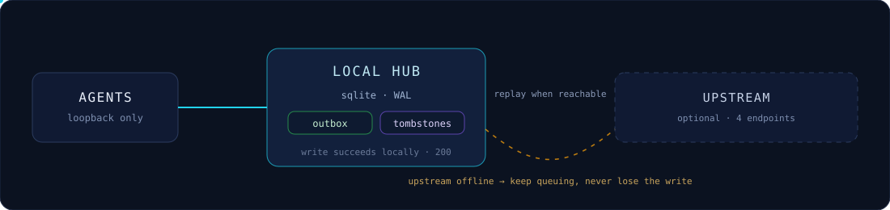

<p align="right"><a href="README.zh-CN.md">简体中文</a> · <b>English</b></p>

<p align="center">
  
</p>

# MEMHUB · local-first agent memory

`local-first-agent-memory` · reference implementation · Node ≥ 22.5 · zero npm dependencies · [](https://github.com/YHGDSa/local-first-agent-memory/actions)

> **Status: reference implementation.** This hub ran as the primary memory path for a multi-agent workflow from 2026-10-28 to 11-20, then was retired when the upstream service became usable and the workflow moved back to it. The code is kept because its **semantics** — write criterion, outbox replay, idempotent dedup, scope isolation, credential redaction, single writer, cross-machine dedup/tombstones/reconcile — are worth more than a feature list. Every claim below is covered by tests: `test/smoke.mjs` 41 assertions (single machine) + `test/multi-hub.mjs` 19 assertions (two machines, one upstream).

A zero-dependency, local-first memory service: **a write succeeds locally first**, and is queued in an outbox; the upstream receives it later, when it is reachable. The goal is to turn "memory" from a store-and-query feature into an engineering component with **lifecycle constraints**. Runnable commands are in the next section.

**Contents**

1. [Quick start](#1-quick-start)
2. [Why this exists](#2-why-this-exists)
3. [Architecture](#3-architecture)
4. [Reusability: can it run without an upstream?](#4-reusability-can-it-run-without-an-upstream)
5. [Contract](#5-contract)
6. [Semantics](#6-semantics-the-part-that-matters)
7. [Retrieval: why not vectors](#7-retrieval-why-not-vectors)
8. [Layout](#10-layout)

---

## 1. Quick start

Node ≥ 22.5 (uses the built-in `node:sqlite`) and **zero npm dependencies**: no `npm install`, just run it.

```bash
cp config.example.json config.json
# 1) generate a secret and put it where config.secretFile points
node -e "console.log(require('crypto').randomBytes(24).toString('hex'))" > secret
# 2) start the hub (the argument is the config path; it can be omitted)
node src/hub.mjs ./config.json
# 3) health check (the only endpoint without auth)
curl http://127.0.0.1:3111/agentmemory/livez
# 4) write one memory, search one
node src/mem.mjs put --title "demo" --content "writes must survive an outage" --tags demo
node src/mem.mjs get --query "outage"
```

> For non-ASCII content use `--content-file` or `put-json --file` (a UTF-8 file body). Passing non-ASCII through argv makes the shell transcode it into the local code page — that writes corrupted bytes. This is a bug we hit, not defensive guessing.

### Verify without a real upstream

```bash
node test/smoke.mjs       # 41 assertions: offline write -> replay -> dedup -> delete -> tombstones -> snapshot
node test/multi-hub.mjs   # 19 assertions: two hubs, one upstream -> dedup -> revisions -> delete stays deleted -> reconcile self-heal
```

```
41/41 assertions passed   (single machine)
19/19 assertions passed   (two machines, one upstream)
```

The stub inside `test/multi-hub.mjs` is a minimal upstream (online/offline switchable); you do not need a second machine or a cloud VM. Both suites run in CI.

## 2. Why this exists

When several coding agents (different clients, different machines) each keep their own context, three problems show up:

1. **Nothing can be written while the upstream is down.** Memory clients treat "the remote answered" as success, so one blip in the tunnel loses the memory.
2. **Replay duplicates.** Writes made offline are replayed on reconnect, so the same content ends up in two places; the next pull imports it as a new record.
3. **Sharing leaks.** A memory body once contained a token, a private key and a URL with a password; as soon as it went upstream, every client could read it.

None of these is solved by a stronger retrieval algorithm. They are problems of **write semantics, idempotency keys, scope and redaction** — which is all this project does.

## 3. Architecture

<p align="center">
   local hub -> outbox -> upstream" width="100%">
</p>

```
 Agent A / Agent B / CLI
        │  Authorization: Bearer <secret>
        ▼
 ┌──────────────────────────────────────────┐
 │ hub  (src/hub.mjs, 127.0.0.1:3111)       │
 │  ├─ HTTP routes + a single Bearer check  │
 │  ├─ SQLite (node:sqlite, WAL)            │
 │  │    memories / outbox / skills / meta  │
 │  ├─ outbox replay (60 s timer, manual)   │
 │  └─ snap/latest.json  atomic (tmp+rename)│
 └───────────────┬──────────────────────────┘
                 │ HTTP, allowed to fail
                 ▼
        127.0.0.1:3112  SSH tunnel (keepalive) -> upstream memory service
```

- **This machine is the only writer**; the upstream is a passive replica. That is why a local write can return immediately without betting availability on the network.
- **Port split**: 3111 always belongs to the local hub, the tunnel uses 3112. Otherwise the tunnel would take 3111, clients would treat the upstream as the only truth, and offline would stop working.
- **Skill index**: the directory on disk is the only writer; the `skills` table is just an index, and `POST /hub/skills` returns 409. Two writable copies always drift.

## 4. Reusability: can it run without an upstream?

This repository is "a reference implementation of memory semantics + a service you can run locally", bound to no particular upstream.

**What runs on its own**

- **Environment**: Node ≥ 22.5 (built-in `node:sqlite`), **zero npm dependencies** — no `npm install`, just `node src/hub.mjs`.
- **Injectable config**: `node src/hub.mjs <config.json>` or `HUB_CONFIG=<path>`; `port / upstream / secretFile / db / snapDir / skillsDir / syncIntervalMs` all come from config. No hard-coded ports, paths or host names.
- **Upstream unreachable is normal**: writes still return 200, search reads the local database, the snapshot refreshes every 5 minutes, and the outbox accumulates. `livez` reporting `upstream:"offline"` is a **normal state**, not a failure.
- **Cross-machine sharing needs you to bring an upstream**: any service implementing four endpoints is enough — `GET /agentmemory/livez`, `GET /agentmemory/export`, `POST /agentmemory/remember`, `POST /agentmemory/forget`. Everything else (`smart-search`, `memories`, `import`, `hub/status`, `hub/skills*`) is local capability.
- **Don't know what an upstream looks like?** Read `startStub` in `test/smoke.mjs`: it is the minimal reference implementation of those four endpoints (switchable online/offline), and the smoke test uses it to prove offline write and replay.
- **Multiple machines**: run one hub per machine and share one upstream; offline-first stays on every machine. See [`docs/topologies.md`](docs/topologies.md) for three topologies and their costs, and [`docs/consistency.md`](docs/consistency.md) for cross-machine dedup / revisions / deletes.

**Explicit limits**

- Retrieval is LIKE + weights (title 3 / tags 2 / body 1) + a 30-day recency decay, **not vector recall**: no embeddings, no semantic similarity. At a larger scale, switch to FTS5 or vectors (see ADR-008).
- Single-writer assumption: no two processes may write the same database file; no multi-tenancy and no per-subject auth (one shared Bearer token).
- No Docker packaging; `tools/tunnel-watchdog.py` is only verified on Windows.

## 5. Contract

Every endpoint except `livez` requires `Authorization: Bearer <secret>`.

| Method | Path | Purpose |
|---|---|---|
| GET | `/agentmemory/livez` | Health: upstream state, memory count, pending writes (no auth) |
| GET | `/agentmemory/health` | Same plus skill count and last sync time |
| POST | `/agentmemory/remember` | Write one: `{title, content, tags, project, type, scope}` → `{success, redacted, memory}` |
| POST | `/agentmemory/smart-search` | Search: `{query, limit}` → `{results:[{layer, title, scope, score, content}]}` |
| GET | `/agentmemory/memories` | List, newest update first |
| GET | `/agentmemory/export` | Full export (also the snapshot format) |
| POST | `/agentmemory/import` | Import (full or partial), upsert by id |
| POST | `/agentmemory/forget` | Delete: `{memoryIds:[...]}`; also cancels queued pushes and writes a tombstone |
| POST | `/agentmemory/revise` | Revise: `{memoryId, title?, content?}`; keeps the entity id so other machines resolve it by LWW |
| POST | `/agentmemory/sync` | Manual sync: `{upstream, pull:{pulled,added,merged,suppressed,cleaned}, push:{pending,pushed}}` |
| POST | `/hub/reconcile` | Full reconciliation: collapse duplicates by content id, compact versions by entity id, re-push missing rows, compact expired tombstones |
| GET | `/hub/status` | Sync state, last report, db and snapshot paths |
| GET/POST | `/hub/skills`, `/hub/skills/reindex`, `/hub/skills/:name` | Skill index (read-only; writes return 409) |

## 6. Semantics (the part that matters)

**① The write criterion is local success, not upstream reachability.**
`remember` writes SQLite, appends an outbox row, and only then returns 200. While the upstream is offline the response says `upstream:"offline"` and `pendingWrites` grows — normal state, not a failure.

**② The replay idempotency key is `upstream_id`, not a content hash.**
After a successful push the upstream id is written back to the local row; on pull, an upstream record whose id already appears in some local `upstream_id` is skipped. Otherwise the same content would exist twice ("local id row" + "upstream id row"). The regression criterion is fixed: write → push → pull again, `added: 0` and the row count unchanged.

**③ Scope decides whether a memory may travel, not whether it is visible.**
Four levels: `global / project / agent / private`. `private` **never writes an outbox row**, so it can never reach the upstream or another device; it is still searchable locally.

**④ Redaction happens on the write path, before persistence.**
Five pattern classes (PEM private-key blocks, `sk-`/`ghp_`/`xox?`/`AKIA` prefixes, `Bearer xxx`, `user:pass@` in URLs, JSON `api_key` fields) are replaced with `[REDACTED]` before the row is stored, and the response returns the hit count. Pattern-based redaction narrows the leak surface for known shapes; it is not a substitute for secret management.

**⑤ Delete locally first, forward best-effort; a failed forward does not roll back.**
Better one row short locally than a deleted fact coming back. Deletion must also drop the queued push for that id — otherwise the replay recreates it and the delete silently undoes itself minutes later.

**⑥ Single writer.** Never open `hub.db` from a second process while the hub is running: the WAL checkpoint at shutdown can clip the tail being appended. Read through HTTP, and stop the service before truncating the WAL.

**⑦ Conflicts are LWW (by `updated_at`), not distributed consensus.**
This workload has no concurrent same-id writes; calling it "strongly consistent" would be over-claiming.

**⑧ Cross-machine dedup uses a content id, not the upstream.**
Every memory gets a `cid` at write time (hash of the normalised project/type/title/content) and carries it upstream as a `cid:<hash>` tag; on pull, one row per cid survives. Since the upstream only has to store tags, dedup needs no new fields — see `docs/consistency.md`.

**⑨ Delete writes a tombstone, not just a missing row.**
Deletion records a `cid` tombstone, cancels the queued push, forwards a `forget` upstream, and appends an ordinary record with `type=tombstone` (tag `tomb:<cid>`). Other machines delete their copy when they see it; re-creating the same content inside the tombstone TTL (default 30 days, `tombstoneTtlDays`) returns 409, and is allowed afterwards.

**⑩ Revisions share an entity id; reconciliation cleans up.**
`revise` updates the local row in place and appends a new version with the same `eid`; other machines match the old version by eid and overwrite it by LWW, so no parallel fact appears. Historical versions and duplicates are cleaned by `POST /hub/reconcile`, which also re-pushes rows missing upstream (self-heal) and compacts expired tombstones.

## 7. Retrieval: why not vectors

The workload is tens of memories across a handful of projects, mostly Chinese substring queries. The score is:

```
hit weights: title 3 / tags 2 / body 1
recency = 1 / (1 + ageDays / 30)
score   = min(1, raw * 0.85 + recency * 0.15)
```

A vector store needs an embedding service, index rebuilds and one more failure path; at this scale it buys no measurable recall. At a larger scale (tens of thousands of rows, cross-language, semantic queries) FTS5 or vectors are the right call — a different trade-off, not this project's goal.

## 8. Two incidents from this build

**Duplicate rows on pull.** After a successful push the local row already had `upstream_id`, so the next pull inserted the same record again under the upstream id. The fix dedups on `upstream_id` before inserting; the regression criterion is `added: 0`.

**WAL double-open lost rows.** A second process opened the database while the hub was running; the shutdown checkpoint clipped the tail being appended and six rows vanished. The fix was not a lock but an architecture change: single writer + reads through the API + stop before truncating the WAL. The failure was silent (no error, just counts that did not add up), so "written rows == queried rows" is now a self-check.

## 9. Non-goals

- Not a production system: one user, two devices, about three weeks of real use; no load testing, no multi-tenancy, one shared secret.
- Not a distributed system: multiple machines rely on "append + content-id dedup + tombstones + full reconciliation", not a consensus protocol; concurrent edits to one memory lose one side (LWW).
- Not a memory database: no graph index, no context compression, not the 54 MCP tools; this is a contract subset.
- No recall evaluation: `docs/evaluation.md` records behavioural drills, metrics are marked as not measured, and nothing is written as a result.
- No deployment artifact beyond Docker-free CI: it is a small resident service, not a distributable product.

## 10. Layout

```
src/hub.mjs                the service (HTTP + SQLite + outbox + snapshots + skill index)
src/mem.mjs                explicit CLI bridge: put / put-json / get / list / status
tools/tunnel-watchdog.py   port watchdog: restarts 3111/3112 only when they are down
test/smoke.mjs             end-to-end smoke: 41 assertions, stub upstream with online/offline
test/multi-hub.mjs         two machines, one upstream: 19 assertions
docs/architecture.md       components, data model, four paths, invariants
docs/decisions.md          10 design decisions (options / choice / consequence)
docs/topologies.md         three deployment topologies and network paths
docs/consistency.md        cross-machine consistency: cid/eid/tombstone tags, reconciliation
docs/evaluation.md         the 2026-10-28 drill log + metric plan (honestly unmeasured)
docs/data-stats.md         data scale, one page
docs/assets/banner.svg     animated banner (this page)
docs/assets/flow.svg       animated write path (agents -> hub -> outbox -> upstream)
README.zh-CN.md            Simplified Chinese version of this file
```

## 11. License

MIT. See `LICENSE`.
