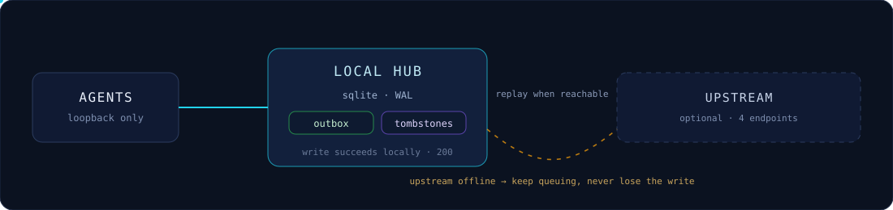

<p align="right"><b>简体中文</b> · <a href="README.md">English</a></p>

<p align="center">
  
</p>

# MEMHUB · 本地优先 Agent 记忆层

参考实现 · Node ≥ 22.5 · 零 npm 依赖 · [](https://github.com/YHGDSa/local-first-agent-memory/actions)

> **状态：参考实现。** 这里的语义来自一个自用的本地优先 hub：它在 2026-10-28 ~ 11-20 作为多 Agent 工作流的主记忆通道实际运行（39 条记忆、2 台设备、一次 WAL 双开事故丢了 6 条）；上游服务恢复可用后归档停用。**本仓库是把这套语义脱敏重写、并补上跨机去重/墓碑/对账的零依赖参考实现——一天写完，git 历史可以作证。** 下面每一条行为都由测试兜底：`test/smoke.mjs` 42 条 + `test/multi-hub.mjs` 19 条；实测数字（写入可用性、补推收敛、检索延迟）见 [`docs/evaluation.md`](docs/evaluation.md)。

一个零第三方依赖的本地优先记忆服务：**写入先落本地并返回成功**，同时投递 outbox；上游可用时按序补推，不可用时保留重试。目标是把「记忆」从「能存能查」做成一套**有生命周期约束**的工程件。能跑的命令在下一节。

**目录**

1. [快速开始（含可运行命令）](#1-快速开始)
2. [为什么做这个](#2-为什么做这个)
3. [架构](#3-架构)
4. [复用性：脱离上游也能用](#4-复用性能不能脱离上游用)
5. [契约（API）](#5-契约)
6. [语义：写入 / 去重 / 墓碑 / 对账](#6-语义这个项目真正的部分)
7. [检索：为什么不是向量](#7-检索为什么不是向量)
8. [仓库结构](#10-目录)

---

## 1. 快速开始

需要 Node ≥ 22.5（用到内置 `node:sqlite`），**零 npm 依赖**：不用 `npm install`，直接跑。

```bash
cp config.example.json config.json
# 1) 生成一个 secret，写进 config.secretFile 指向的文件
node -e "console.log(require('crypto').randomBytes(24).toString('hex'))" > secret
# 2) 起服务（参数是 config 路径，可省略）
node src/hub.mjs ./config.json
# 3) 健康检查（唯一免鉴权的端点）
curl http://127.0.0.1:3111/agentmemory/livez
# 4) 写一条、搜一条
node src/mem.mjs put --title "示例" --content "断网时也要能写" --tags demo
node src/mem.mjs get --query "断网"
```

> 中文内容请走 `--content-file` 或 `put-json --file`（UTF-8 文件体）。把非 ASCII 塞进命令行参数会被 shell 转成本地代码页，写进去就是坏数据——这是踩过的坑，不是防御性猜测。

### 不用真上游也能验证

```bash
node test/smoke.mjs       # 42 条：离线写入 → 恢复补推 → 去重 → 删除 → 墓碑 → 快照
node test/multi-hub.mjs   # 19 条：两机一上游 → 重复收敛 → 修订传播 → 删除不复活 → 对账自愈
```

```
41/42 assertions passed   (single machine)
19/19 assertions passed   (two machines, one upstream)
```

`test/multi-hub.mjs` 里的 stub 就是最小上游（可切换在线/离线），不需要第二台机器或云主机；两个套件都在 CI 里跑。

## 2. 为什么做这个

多个编码 Agent（不同客户端、不同设备）各存各的上下文时，会出现三类问题：

1. **上游一断就写不进去。** 记忆客户端把「远端可达」当成成功判据，隧道抖一下，这条记忆就丢了。
2. **补推会重复。** 断网期间写入、恢复后重放，同一内容在远端与本地各有一份；下一次拉取又把它当成新记录。
3. **跨 Agent 共享会泄密。** 记忆正文里粘进过 token、私钥、带口令的 URL，一旦上浮就被所有客户端读到。

这三个问题都不是「换一个更强的检索算法」能解决的，而是**写入语义、幂等键、作用域与脱敏**的问题。这个项目就只做这四件事。

## 3. 架构

<p align="center">
  
</p>

```
 Agent A / Agent B / CLI
        │  Authorization: Bearer <secret>
        ▼
 ┌──────────────────────────────────────────┐
 │ hub  (src/hub.mjs, 127.0.0.1:3111)       │
 │  ├─ HTTP 路由 + 单一 Bearer 鉴权         │
 │  ├─ SQLite (node:sqlite, WAL)            │
 │  │    memories / outbox / skills / meta  │
 │  ├─ outbox 重放（60 s 轮询，显式 sync）  │
 │  └─ snap/latest.json  原子快照（tmp+rename）│
 └───────────────┬──────────────────────────┘
                 │ HTTP，可失败
                 ▼
        127.0.0.1:3112  SSH 隧道（keepalive）→ 上游记忆服务
```

- **本机是唯一写者**，上游是被动副本。所以「本地写成功」可以立刻返回，而不会把可用性押在网络上。
- **端口分工**：3111 永远属于本机 hub，隧道只用 3112。否则隧道会抢走 3111，客户端把上游当唯一真相，离线即失效。
- **技能索引**：磁盘目录是唯一写者，`skills` 表只是索引；`POST /hub/skills` 直接 409。两处可写必然漂移。

## 4. 复用性：能不能脱离上游用

这个仓库的定位是「记忆语义的参考实现 + 可独立运行的本地服务」，不绑定任何特定上游。

**能独立跑的部分**

- **环境**：Node ≥ 22.5（用内置 `node:sqlite`），**零 npm 依赖**——不需要 `npm install`，直接 `node src/hub.mjs`。
- **配置可注入**：`node src/hub.mjs <config.json>` 或 `HUB_CONFIG=<path>`；`port / upstream / secretFile / db / snapDir / skillsDir / syncIntervalMs` 全部来自配置，没有硬编码端口、路径或主机名。
- **上游不可达时本地照常**：写入仍返回 200、检索走本地库、快照每 5 分钟刷新、outbox 累积待补推。`livez` 返回 `upstream:"offline"` 是**正常态**，不是故障。
- **跨机共享需要你自备上游**：只要有一个实现以下四个端点的服务即可——`GET /agentmemory/livez`、`GET /agentmemory/export`、`POST /agentmemory/remember`、`POST /agentmemory/forget`。其余端点（`smart-search`、`memories`、`import`、`hub/status`、`hub/skills*`）都是本机能力，不需要上游。
- **不知道上游该长什么样**：看 `test/smoke.mjs` 里的 `startStub`——它就是这四个端点的最小参考实现（可切换在线/离线），冒烟测试正是靠它验证离线写入与恢复补推。
- **多机**：每台机器各跑一个 hub，共享同一个上游即可（离线优先仍在每台机器上）。三种拓扑与成本见 [`docs/topologies.md`](docs/topologies.md)，跨机去重 / 修订 / 删除的实现见 [`docs/consistency.md`](docs/consistency.md)。

**明确的能力边界**

- 检索是 LIKE + 权重（标题 3 / 标签 2 / 正文 1）+ 30 天时间衰减打分，**不是向量召回**：没有 embedding、没有语义相似度。规模上来应换 FTS5 或向量（见 ADR-008）。
- 单写者假设：不支持多个进程同时写同一个库文件；也不支持多租户与按主体鉴权（单一 Bearer token）。
- 没有 Docker 打包；`tools/tunnel-watchdog.py` 只在 Windows 下验证过。


## 5. 契约

除 `livez` 外所有端点都要 `Authorization: Bearer <secret>`。

| 方法 | 路径 | 作用 |
|---|---|---|
| GET | `/agentmemory/livez` | 健康检查：`upstream` 在线状态、条数、未推送数（免鉴权） |
| GET | `/agentmemory/health` | 同上 + 技能数、上次同步时间 |
| POST | `/agentmemory/remember` | 写入一条：`{title, content, tags, project, type, scope}` → `{success, redacted, memory}` |
| POST | `/agentmemory/smart-search` | 检索：`{query, limit}` → `{results:[{layer, title, scope, score, content}]}` |
| GET | `/agentmemory/memories` | 按更新时间倒序列出 |
| GET | `/agentmemory/export` | 全量导出（也是快照格式） |
| POST | `/agentmemory/import` | 全量/增量导入，按 id upsert |
| POST | `/agentmemory/forget` | 删除：`{memoryIds:[...]}`，同时取消未推送的 outbox，并写入墓碑 |
| POST | `/agentmemory/revise` | 修订：`{memoryId, title?, content?}`；保持同一 entity id，让其它机器按 LWW 覆盖旧版本 |
| POST | `/agentmemory/sync` | 手动同步：`{upstream, pull:{pulled,added,merged,suppressed,cleaned}, push:{pending,pushed}}` |
| POST | `/hub/reconcile` | 全量对账：按内容 id 收敛重复、按 entity id 压缩旧版本、重推缺失行、压缩过期墓碑 |
| GET | `/hub/status` | 同步状态、上次报告、db 与快照路径 |
| GET/POST | `/hub/skills`, `/hub/skills/reindex`, `/hub/skills/:name` | 技能索引（只读；POST 写入返回 409） |

## 6. 语义（这个项目真正的部分）

**① 写入判据是本地成功，不是上游可达。**
`remember` 先落 SQLite、再插一条 outbox，然后才返回 200。上游离线时响应里 `upstream:"offline"`、`pendingWrites` 递增——这是正常状态，不是故障。

**② 补推的幂等键是 `upstream_id`，不是内容哈希。**
推送成功后把上游 id 回填到本地行；拉取时若某条上游记录的 id 已出现在本地的 `upstream_id` 里，跳过。否则同一内容会以「本地 id 行 + 上游 id 行」出现两份。回归判据固定为：写入 → 推送 → 再拉取，`added: 0` 且总行数不变。

**③ 作用域决定「能不能上浮」，不是「能不能看到」。**
`global / project / agent / private` 四级。`private` **不写 outbox**，因此永远不上游、不被其它设备看到；本地仍可搜（同一台机器）。

**④ 脱敏发生在写入路径，早于落库。**
5 类模式（PEM 私钥块、`sk-`/`ghp_`/`xox?`/`AKIA` 前缀、`Bearer xxx`、URL 里的 `user:pass@`、JSON 的 `api_key` 字段）在入库前替换为 `[REDACTED]`，响应返回命中数。规则式脱敏只收敛已知模式的泄漏面，不替代密钥管理。

**⑤ 删除先本地、再尽力转发；转发失败不回滚。**
宁可本地少一条，也不要复活已删数据。删除时还必须清掉 outbox 里该 id 的待推送记录——否则恢复后那条写又被重放，删除会在几分钟后自己失效。

**⑥ 单写者。** 不在 hub 运行时用第二个进程直接开 `hub.db`：WAL 收尾的 checkpoint 会把正在追加的尾部折掉。查看数据走 HTTP，收拢 WAL 前先停服务。

**⑦ 冲突是 LWW（按 `updated_at`），不是分布式共识。**
这个场景没有并发同 id 写入；把它写成「强一致」是过度声称。

**⑧ 跨机去重靠内容 id，不靠上游。**
每条记忆在写入时算出 `cid`（归一化后的 project/type/title/content 的哈希），并作为 `cid:<hash>` 标签随记录上行；拉取时同 cid 只保留一行。既然上游只保证存标签，去重就不需要它新增字段——详见 `docs/consistency.md`。

**⑨ 删除写墓碑，而不是只删一行。**
删除时记下 `cid` 墓碑、取消待推送、转发上游 forget，并追加一条 `type=tombstone` 的普通记录（带 `tomb:<cid>` 标签）。其它机器同步时看到墓碑就删掉自己的副本；墓碑 TTL（默认 30 天，`tombstoneTtlDays`）内重写同一内容返回 409，之后允许重新记录。

**⑩ 修订共享 entity id，对账负责收敛。**
`revise` 原地更新并追加一条同 `eid` 的新版本；其它机器按 eid 命中旧版本后 LWW 覆盖，不会多出一条平行事实。历史版本与重复行由 `POST /hub/reconcile` 统一清理，它还会重推上游缺失的行（self-heal）、压缩过期墓碑。

## 7. 检索：为什么不是向量

单机规模（个位数项目、几十条记忆）、中文子串为主。打分是：

```
命中权重：标题 3 / 标签 2 / 正文 1
recency = 1 / (1 + ageDays / 30)
score   = min(1, raw * 0.85 + recency * 0.15)
```

引入向量库需要 embedding 服务、索引重建和一条新的失败路径，而在这个规模上换不来可测的召回收益。规模上去（上万条、跨语言、语义查询）应该换 FTS5 或向量——那是另一个取舍，不是这个项目的目标。

## 8. 这次实现里学到的两个故障

**pull 重复行。** 补推成功后本地行的 `upstream_id` 已回填，下一次拉取把同一条记录按上游 id 再插一遍。修复是拉取前按 `upstream_id` 查重；回归判据 `added: 0`。

**WAL 双开丢数。** hub 运行时用第二个进程直接打开数据库读写，收尾的 checkpoint 折掉了正在追加的尾部，丢过 6 条。修复不是加锁，而是**改架构**：单写者 + 只读走 API + 收拢 WAL 前先停服务。故障是静默的（没有报错，只是计数对不上），所以现在把「写入条数 == 查询条数」当成一条自检。

## 9. 不做什么（明确边界）

- 不是生产系统：单用户、双设备、约 3 周实际使用；没有压测、没有多租户、鉴权只有一个共享 secret。
- 不是分布式系统：多机靠「追加 + 内容 id 去重 + 墓碑 + 全量对账」，不是共识协议；并发编辑同一条记忆会丢一侧（LWW）。
- 不是记忆数据库：没有图索引、没有上下文压缩、没有 54 个 MCP 工具；这是契约子集。
- 没有做召回评测：`docs/evaluation.md` 记录的是行为级演练，指标待测，不写成结果。
- Docker/CI 之外没有部署产物：定位是「本机常驻的小服务」，不是可分发产品。

## 10. 目录

```
src/hub.mjs                服务本体（HTTP + SQLite + outbox + 快照 + 技能索引）
src/mem.mjs                显式调用桥：put / put-json / get / list / status
tools/tunnel-watchdog.py   端口看门狗：3111/3112 掉了才拉起，避免双开
test/smoke.mjs             端到端冒烟：42 条断言，含一个可切换在线/离线的 stub 上游
test/multi-hub.mjs         两机一上游：19 条断言（复制 / 去重 / 修订 / 删除 / 对账自愈）
test/metrics.mjs           测量脚本：写入可用性 / 补推收敛 / 检索延迟（不断言）
docs/architecture.md       组件、数据模型、四条主链路、不变量
docs/decisions.md          10 条设计决策（备选 / 取舍 / 后果）
docs/topologies.md         三种部署拓扑：单机、双机、虚拟机/云上游与网络路径
docs/consistency.md        跨机一致性：tags 携带 cid/eid/墓碑、对账的四个步骤与代价
docs/evaluation.md         2026-10-28 演练记录 + 指标计划（诚实标注未测）
docs/data-stats.md         数据规模一页（聚合口径）
README.zh-CN.md            本文件（简体中文）；README.md 为英文版
docs/assets/banner.svg     顶部动画横幅
docs/assets/flow.svg       写路径动画（Agent → hub → outbox → 上游）
```

## 11. 许可

MIT。见 `LICENSE`。
